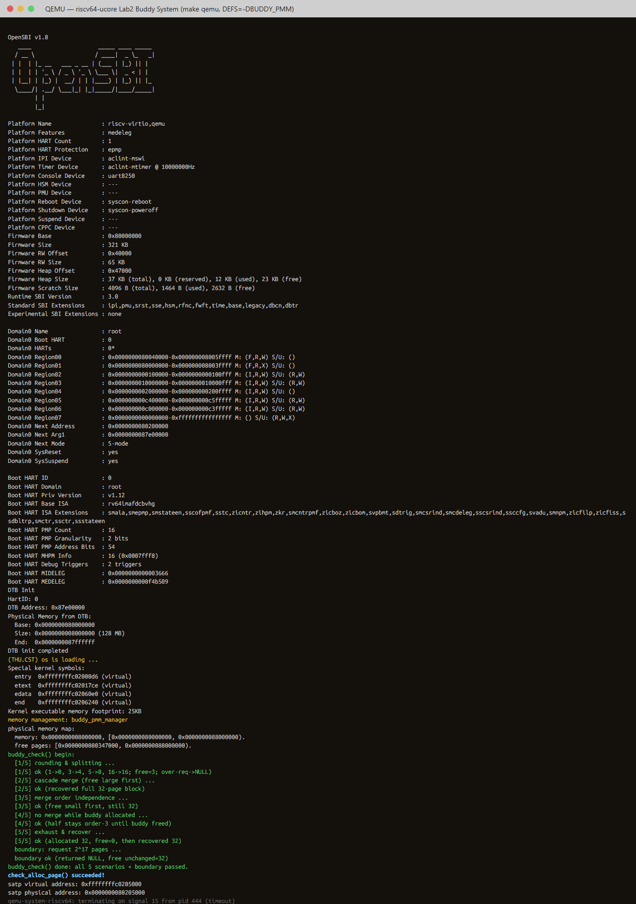
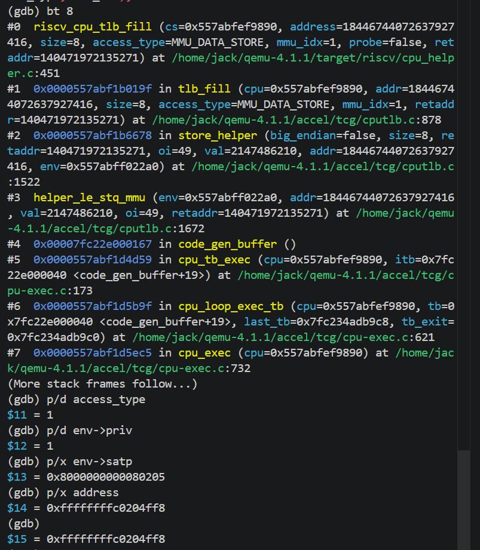
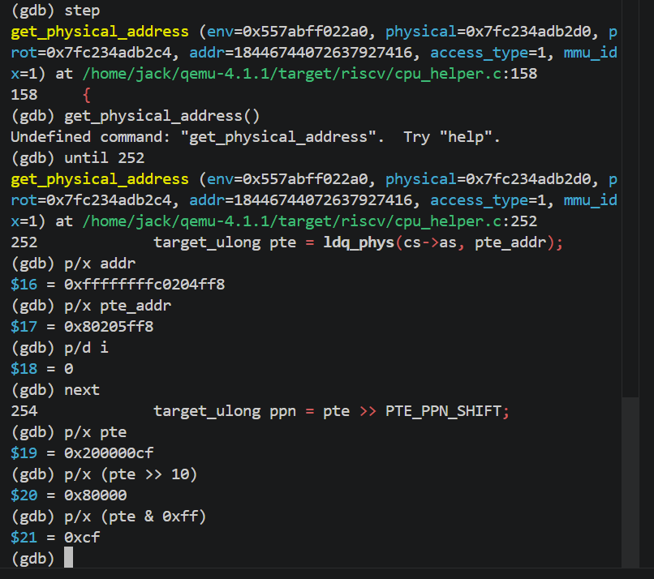
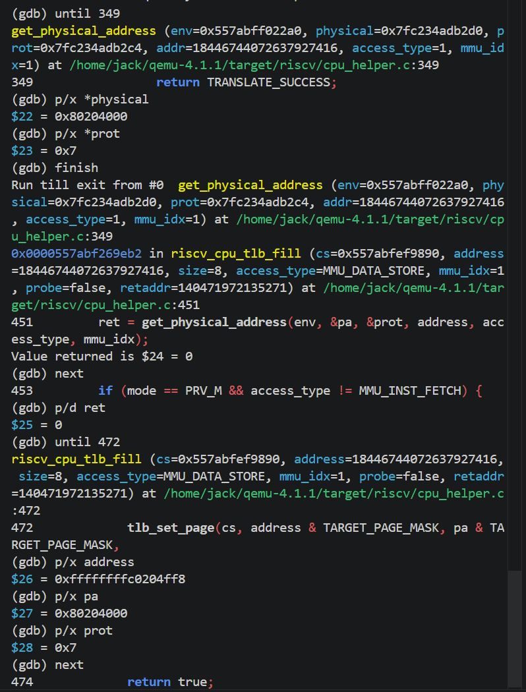
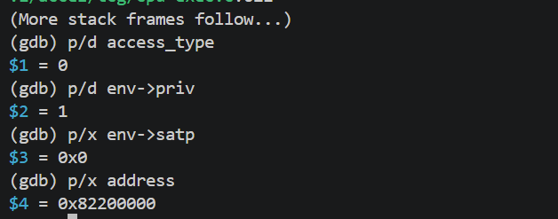
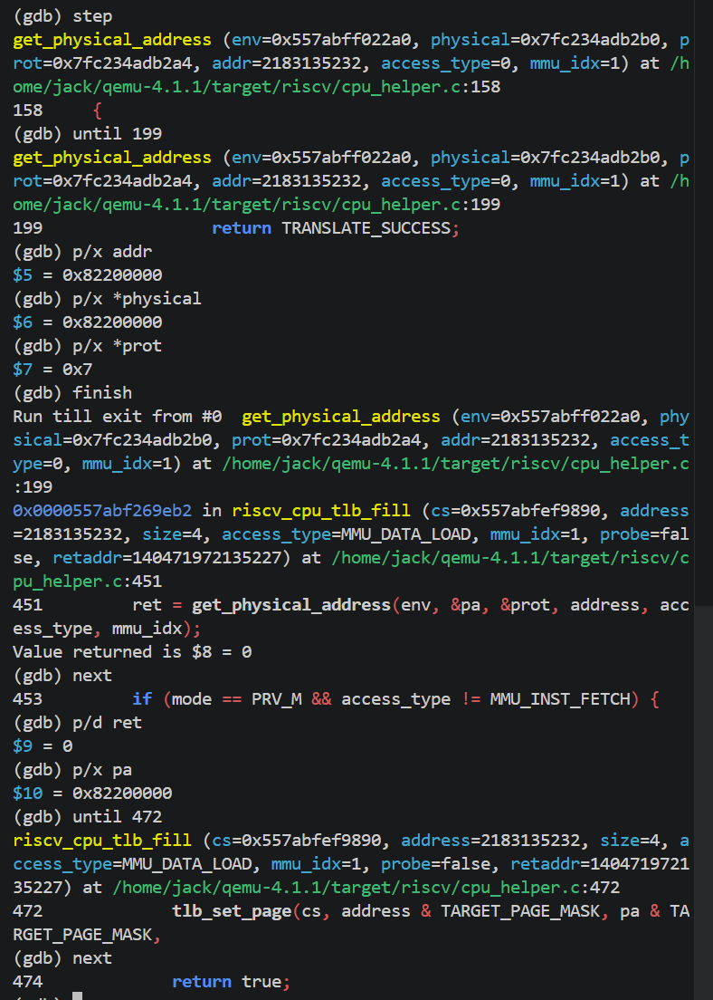
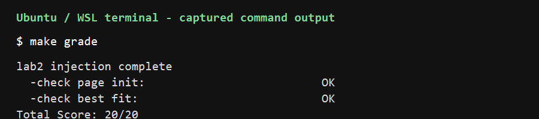
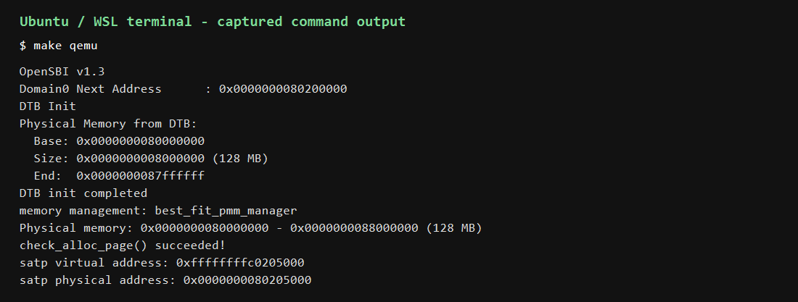
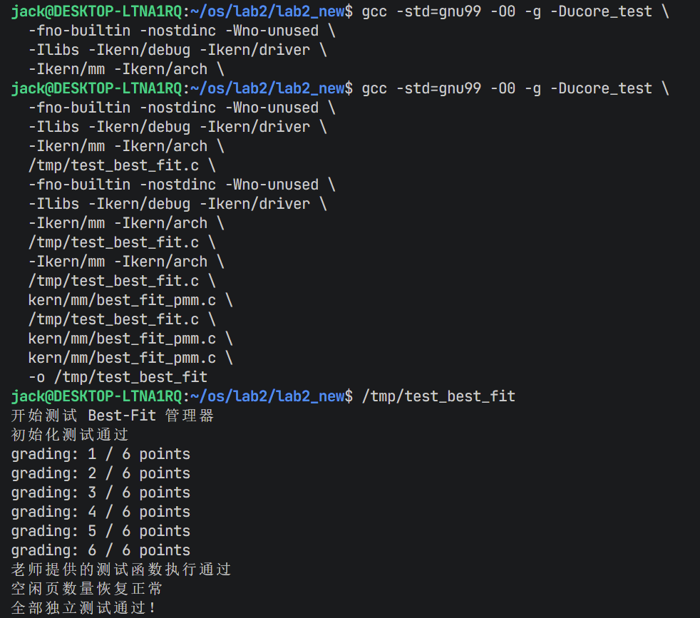

# 操作系统实验报告

## 实验基本信息

| 项目 | 内容 |
|------|------|
| **实验名称** | Lab 2: [物理内存和页表] |
| **小组成员** | 2311958-王健烨、2313107-程晓耘、2312681-仇晨宇 |
| **完成日期** | 2026-10-22 |

### 小组分工

| 成员 | 负责的练习/模块 |
|------|----------------|
| 2313107-程晓耘 | 功能模块一任务一：物理内存探测与页描述符初始化；功能模块二任务一：理解 First-Fit 连续物理内存分配算法 |
| 2311958-王健烨 | [功能模块二任务二:实现最佳适应连续物理内存分配算法；QEMU分支任务 调试要求3、4] |
| 2312681-仇晨宇 | [功能模块二任务三：实现 Buddy System（伙伴系统）分配算法；QEMU分支任务 调试要求5、6] |

---

## 一、实验目的


本实验的主要目的是：

1. [目的1：理解页表的建立和使用方法]
2. [目的2：理解物理内存的管理方法]
3. [目的3：理解页面分配算法]

---

## 二、实验环境

你们使用的 AI 工具

| 成员 | AI 编程工具 | 底层模型 | 备注 |
|------|------------|---------|------|
| 2313107-程晓耘 | VS Code（Copilot SDK） | 当前会话未显示具体版本 | |
| 2311958-王健烨 | Claude Code（终端 Agent）| DeepSeek-V4-Flash | |
| 2312681-仇晨宇 | 豆包（Doubao 工作模式）| Doubao 模型 | |

**说明：**
- **AI 编程工具**：指具体使用的终端工具、编辑器插件、桌面应用或浏览器界面
- **底层模型**：指该工具使用的大语言模型及版本

---

## 三、实验整体逻辑分析

本章按照“发现物理内存—建立页级管理元数据—实现物理页分配—观察虚拟地址转换”的顺序展开。内核启动后先由设备树解析得到 DRAM 的物理基址和大小；`pmm_init()` 选择并初始化一个物理内存管理器，随后 `page_init()` 为物理页建立 `struct Page` 描述符，保留 OpenSBI、内核映像和描述符数组占用的区域，并把剩余完整页面交给管理器。之后管理器通过统一接口分配、释放连续物理页；本实验先阅读 First-Fit，再实现 Best-Fit 和 Buddy System。最后通过 Sv39 页表与 QEMU 调试观察虚拟地址到物理地址的转换。整体调用关系可概括为：

```text
dtb_init()
  -> pmm_init()
       -> init_pmm_manager()
       -> page_init()
            -> init_memmap()
       -> pmm_manager->check()
  -> alloc_pages() / free_pages()
```

### 3.1 对每个功能的核心函数或功能模块的理解

**（1）物理内存初始化模块**

- `dtb_init()`：解析设备树，获取物理内存的起始地址和大小，并通过 `get_memory_base()`、`get_memory_size()` 提供给内存管理模块。
- `pmm_init()`：物理内存管理的总入口，依次调用管理器初始化、物理页面初始化和分配功能检查。
- `init_pmm_manager()`：通过 `pmm_manager` 指针选择具体的分配算法，并调用其初始化函数。
- `page_init()`：负责初始化物理页描述符数组，排除内核及管理结构占用的空间，将剩余空闲页面交给分配器。
- `init_memmap()`：调用当前管理器的接口，完成空闲物理页的初始化。

该模块的核心是将设备树提供的物理内存信息转换为操作系统可管理的页面资源。其中，`struct Page` 记录页面状态，`pages` 指向描述符数组，`npage` 记录物理页号上界。

**（2）首次适应分配模块**

- `default_init()`：初始化双向空闲链表，将空闲页数量置零。
- `default_init_memmap()`：初始化页面状态，通过 `property` 记录空闲块大小，并将空闲块插入链表。
- `default_alloc_pages()`：遍历空闲链表，寻找第一个满足请求的空闲块，必要时拆分剩余空间。
- `default_free_pages()`：释放页面，按照地址顺序插入链表，并合并相邻空闲块。
- `default_nr_free_pages()`：返回当前空闲页面数量。

该模块使用 `free_area_t` 管理空闲链表和页面数量，利用 `PageProperty` 标记空闲块起始页。首次适应算法实现简单，但可能产生外部碎片。

**（3）最佳适应分配模块**

`best_fit_pmm.c` 中提供了 `basic_check()` 和 `best_fit_check()` 两个测试函数，分别用于检查基本页面分配、回收功能，以及最佳适应策略、空闲块拆分和合并的正确性。

最佳适应算法与首次适应算法采用相同的物理页管理框架，但分配时需要遍历空闲块，选择满足请求且大小最接近需求的空闲块。

其核心区别是空闲块选择策略不同。最佳适应算法可以减少单次分配的剩余空间，但搜索开销可能更大，并可能产生较小的外部碎片。

**（4）页表与地址转换模块**

- `boot_page_table_sv39`：在 `entry.S` 中定义启动页表，通过根页表中的叶子页表项建立1GiB的大页映射。
- `satp`：保存分页模式和根页表的物理页号，代码通过 `csrw satp, t0` 开启Sv39分页。
- `sfence.vma`：刷新相关地址转换缓存，保证地址映射正确。
- `PADDR()`：根据 `va_pa_offset` 将内核虚拟地址转换为物理地址。
- `page2pa()`、`pa2page()`：实现物理页描述符与物理地址之间的转换。

该模块通过页表建立虚拟地址和物理地址之间的映射，使内核能够运行在高地址虚拟空间。与物理内存分配不同，页表管理解决的是地址转换和访问保护问题。

**（5）QEMU地址转换与TLB调试模块**

QEMU通过软件模拟处理器的访存过程。模拟TLB命中时，可以直接利用缓存的地址映射；未命中时，根据当前分页模式决定是否执行页表遍历，并在转换成功后更新缓存。

该模块的核心是理解虚拟地址转换、TLB查询与物理内存访问之间的关系。真实CPU主要依靠硬件实现TLB，而QEMU通过软件缓存及相关代码模拟这一过程。


---

## 四、实验内容与实现

<!-- 
说明：本部分按照 exercises 文档中的练习顺序组织
每个功能模块或者练习中可能包含多项任务，请根据实际情况调整
-->

### 功能模块一任务一：实现物理内存探测与页描述符初始化

**负责人：** 2313107-程晓耘

#### 模块功能描述

本任务在 `kern/mm/pmm.c` 中实现 `static void page_init(void)`。`dtb_init()` 已经解析并保存设备树中的物理内存基址和大小，`page_init()` 通过 `get_memory_base()`、`get_memory_size()` 取得范围，并设置 `va_pa_offset`。本实验的内存布局以 `DRAM_BASE` 为管理起点，`nbase` 是该起点对应的物理页号，`npage` 是物理内存末端对应的页号；`pages` 指向按页号索引的 `struct Page` 描述符数组。

函数把描述符数组放在链接符号 `end` 之后并按页对齐，检查设备树范围、配置的物理内存上界和描述符数组末端。随后逐个初始化描述符，将页面先标记为保留页；空闲区起点取内核映像末端与描述符数组末端中较高者，并向上按页对齐。最后用 `pa2page()` 把物理地址转换为描述符地址，通过 `init_memmap()` 将 `[free_start, mem_end)` 中的完整页面登记到当前分配器。这样 OpenSBI、内核和描述符数组不会被错误地分配给后续使用者。

#### 任务规格（spec）与提示词（prompt）

**Spec 摘要：** 实现无参数、无返回值的 `page_init()`；从 DTB 获取物理内存范围；正确设置 `va_pa_offset`、`npage` 和 `pages`；输出探测范围；初始化所有可管理页描述符；保留已占用空间；仅将完整、未占用页面交给当前 `pmm_manager`；无效的内存范围或没有可用完整页时不得调用 `init_memmap()`。

**实现任务使用的 prompt：**

```text
请先阅读本工程 kern/mm/pmm.c、pmm.h、memlayout.h、mmu.h、
libs/riscv.h、kern/driver/dtb.h 和链接脚本，再在 kern/mm/pmm.c
实现 page_init()，不要修改其他文件或分配器算法。

要求：使用 get_memory_base()/get_memory_size() 获取 DTB 提供的物理
内存范围；正确设置 va_pa_offset、npage、pages；描述符数组从链接符号
end 之后按 PGSIZE 对齐，并覆盖从 nbase 到 npage 的页面；初始化每个
struct Page 的引用计数、flags、property 和 page_link；先将所有描述符
标为保留页；排除 OpenSBI、内核映像及描述符数组占用范围后，只把剩余
完整物理页通过 init_memmap(pa2page(start), count) 注册给当前管理器。
按工程的 DRAM_BASE、PHYSICAL_MEMORY_END、PHYSICAL_MEMORY_OFFSET 等
布局检查边界，避免地址加法溢出；设备树无效、超出配置上界或没有可用
完整页时显式终止初始化，不得调用 init_memmap()。打印物理内存范围。
保持 page_init() 的函数签名和 pmm_manager 接口不变。完成后说明虚拟
地址、物理地址、PPN 和 Page 描述符索引之间的关系，并给出验证步骤。
```

**First-Fit 理解题使用的 prompt：**

```text
请只依据 kern/mm/default_pmm.c、pmm.h、memlayout.h 中的实际实现，
用中文解释 default_init、default_init_memmap、default_alloc_pages、
default_free_pages 和 default_nr_free_pages 的职责及调用关系。说明
First-Fit 怎样寻找第一个足够大的空闲块、如何拆分、怎样按地址插入
释放块并与相邻块合并；区分外部碎片和内部碎片，并回答该算法还有哪些
改进空间。不要修改源码，不要假设代码中不存在的行为。
```

#### A 同学实际修改的代码与验证

本任务实际修改的核心代码是 `kern/mm/pmm.c` 中的 `page_init()`：由 DTB 读取物理内存起始地址和大小，验证范围和上界，设置 `va_pa_offset`、`npage`，在内核链接符号 `end` 后按页对齐放置 `pages` 描述符数组；然后初始化每个描述符并先标记为保留页。可分配区从内核末端和描述符数组末端两者较高者开始，再向上按页对齐，通过 `init_memmap()` 只登记完整空闲页。这样描述符数组本身不会被分配器误认为可用内存。

为了使本工程在 QEMU 中实际启动并可验证，还修改了启动和运行配置，而不是 First-Fit 分配算法：

- `kern/init/entry.S`：启动时开启 Sv39 后，执行流还需从物理入口继续运行一小段，因此启动页表同时映射物理地址区间和高半区内核地址，之后再跳转到高半区。
- `Makefile`、`tools/grade.sh`：把 QEMU 启动参数从仅加载镜像改为 `-kernel`，让 OpenSBI 获知内核入口；`Makefile` 的 GDB 目标使用 `$(GDB)`，以便在当前 Ubuntu 中指定 `gdb-multiarch`。

调试时观察到，旧的 QEMU `-device loader` 启动方式虽然把镜像放入内存，但 OpenSBI 的 `Next Address` 为 0，内核没有进入执行；切换到 `-kernel` 后又通过 GDB 单步发现 Sv39 开启后的物理执行地址缺少映射。修正启动参数和临时映射后，GDB 断点成功命中 `page_init()`，调用栈为 `kern_init()` → `pmm_init()` → `page_init()`。

当前 WSL 环境的验证结果：RISC-V GCC 13.2.0、QEMU 8.2.2/OpenSBI v1.3 下，`make grade` 输出 `check page init: OK`、`check best fit: OK`、`Total Score: 20/20`；`make qemu` 启动后也输出设备树检测到的 128 MB 物理内存以及 `check_alloc_page() succeeded!`。评分脚本中的分配器检查是 Best-Fit 检查，并不代表 First-Fit 的代码被运行测试；First-Fit 在本任务中是阅读理解内容，没有修改 `default_pmm.c`。课程若要求 QEMU 4.1.1，仍应在指定版本环境复测。

### 功能模块二任务一：理解 First-Fit 连续物理内存分配算法

**负责人：** 2313107-程晓耘

本思考题的 spec 是阅读指定 First-Fit 实现并说明初始化、分配、回收、相邻块合并的行为，同时分析改进空间；该任务要求理解和解释现有代码，不要求新增分配器代码。因此 A 同学没有修改 `default_pmm.c` 来实现 First-Fit。

First-Fit 使用地址有序的双向链表维护空闲块。初始化时，`default_init()` 建立空链表并清零空闲页计数；`default_init_memmap()` 将一段连续页的描述符复位，把块大小保存在首页面的 `property` 中并插入链表。申请 `n` 页时，`default_alloc_pages()` 从链表头开始查找第一个 `property >= n` 的块；找到后从块头分配，若块更大则把剩余部分作为新空闲块重新入链表，并扣减 `nr_free`。释放时，`default_free_pages()` 复位描述符、按物理地址顺序插入空闲链表，再检查并合并前后地址连续的空闲块。`default_nr_free_pages()` 返回当前空闲页数。

First-Fit 的优点是实现简单，通常不必遍历整个链表就能完成分配；缺点是早期空闲块可能被反复切割，逐渐形成许多较小的不连续空闲区，即外部碎片。可以按请求大小分级空闲链表、采用 Best-Fit/Worst-Fit 或 Buddy System、定期合并空闲块，或使用页缓存减少通用分配器的压力。不同方法在查找开销、碎片形态、实现复杂度之间取舍；即便改用其他算法，也不能保证完全消除碎片。

### 功能模块：[功能模块二任务二:实现最佳适应连续物理内存分配算法]

**负责人：** [2311958-王健烨]

#### 模块功能描述

**需要实现/修改的函数：**

```c
// 列出本模块涉及的所有函数签名
// kern/mm/best_fit_pmm.c
// 初始化物理内存管理器
static void best_fit_init(void);
// 初始化连续空闲物理页
static void best_fit_init_memmap(struct Page *base, size_t n);
// 按最佳适应算法分配连续物理页
static struct Page *best_fit_alloc_pages(size_t n);
// 释放连续物理页
static void best_fit_free_pages(struct Page *base, size_t n);
// 查询当前空闲物理页总数
static size_t best_fit_nr_free_pages(void);
// 辅助函数：插入空闲块并合并相邻空闲块
static void best_fit_insert_and_merge(struct Page *base);
// 管理器注册对象
const struct pmm_manager best_fit_pmm_manager;
// kern/mm/pmm.c
// 切换并初始化当前物理内存管理器
static void init_pmm_manager(void);
```

**功能说明：**

本模块负责实现 ucore 操作系统中的最佳适应（Best-Fit）连续物理内存分配算法，为内核提供物理页的初始化、分配、释放和空闲页统计功能。相较于原有的首次适应（First-Fit）算法，Best-Fit 在分配内存时遍历全部空闲块，选择能够满足申请需求且大小最小的连续空闲块，并在必要时对空闲块进行拆分，以减少单次分配后剩余空间的浪费。

模块通过 struct Page 记录物理页状态，利用双向链表维护空闲内存块，并使用 free_area_t 管理空闲链表和空闲页总数。主要处理物理内存初始化、连续页面申请、内存不足导致分配失败、页面释放以及相邻空闲块合并等场景。其中，释放内存时按照物理地址顺序将空闲块插入链表，并合并前后地址连续的空闲块，以缓解外部碎片问题。

在模块交互方面，kern/mm/pmm.c 通过 struct pmm_manager 提供统一的物理内存管理接口。将 init_pmm_manager() 中的管理器切换为 best_fit_pmm_manager 后，内核即可调用 Best-Fit 的初始化、分配和释放函数。模块同时通过实验框架提供的 basic_check() 和 best_fit_check() 验证基本内存管理功能及最佳适应分配逻辑的正确性。

#### 最终提示词

以下是经过迭代优化后，最终成功实现该功能的提示词：

````markdown

我现在要完成实验指导书里的任务二：实现 Best-Fit 连续物理内存分配算法，你需要手把手指导我如何完成。

# 【PROMPT】任务说明

你是一名精通 C 语言、RISC-V 架构和 ucore 操作系统内存管理机制的操作系统实验指导教师。我是一名操作系统初学者，正在完成 Lab2 实验。

我会向你提供完整的实验指导书和项目源代码。你的任务是基于真实文件内容，**一步一步指导我亲自实现 Best-Fit 连续物理内存分配算法，而不是代替我完成任何实际操作。**

## 1. 具体任务

根据实验指导书“功能模块二：物理内存分配功能——任务二”的要求，参考 `kern/mm/default_pmm.c` 中已有的 First-Fit 实现，指导我在 `kern/mm/best_fit_pmm.c` 中标有 `lab2` 和 `YOUR CODE` 的位置实现完整的 Best-Fit 物理内存管理模块。

最终实现应满足实验书的全部要求，能够接入现有的物理内存管理框架，并通过老师提供的测试函数。

## 2. 工作范围

- 只指导我修改 `kern/mm/best_fit_pmm.c`。
- 可以读取其他相关文件帮助分析，但不允许修改它们。
- `kern/mm/pmm.c` 中切换管理器的操作由其他组员负责，你只需在必要时提醒我这一依赖关系。
- 不得修改原有的 `basic_check()` 和 `best_fit_check()` 两个测试函数。
- 不得擅自扩大任务范围、重构整个项目或添加实验书没有要求的功能。

## 3. 交互方式

你必须采用循序渐进的教学模式。

每次只指导我完成一个具体步骤，说明文件位置、需要执行的操作、相关代码的原理，以及如何判断这一步是否正确。

**在我回复“完成”并提供必要的操作结果之前，不得直接进入下一步。**

我希望通过你的指导理解算法，并亲自完成代码编写、修改、保存、编译、运行和调试。

# 【RELY】上下文信息

你可以依据我上传的以下真实工程文件进行分析：

- 实验指导书：确定任务要求、实现约束和验收标准。
- `kern/mm/best_fit_pmm.c`：确定待实现区域、现有测试函数及状态约定。
- `kern/mm/default_pmm.c`：参考 First-Fit 分配器的完整实现。
- `kern/mm/pmm.h`：确认 `struct pmm_manager` 的真实定义和接口签名。
- `kern/mm/memlayout.h`：确认 `struct Page`、页面状态和相关宏的定义。
- `kern/mm/best_fit_pmm.h`：确认 Best-Fit 管理器的声明。
- `libs/list.h`：确认双向链表的数据结构与操作接口。
- `kern/mm/pmm.c`：只读，了解管理器如何被初始化和调用。
- `Makefile`：只读，确定正确的编译与测试命令。

请严格遵守以下原则：

1. 所有函数签名、结构体成员、宏、变量和接口必须以实际工程文件为准，不能凭经验猜测。
2. 只提取与本任务直接相关的信息，不必分析无关模块。
3. 如有缺失文件或信息，明确告诉我需要提供什么，不得编造。
4. 如果实验书与实际代码存在差异，应明确指出差异并解释如何处理，不能擅自修改测试或框架来掩盖问题。
5. 所有分析和说明均使用中文，保留实际代码中的函数名、变量名与必要的技术标识符。

# 【GUARANTEE】接口清单与实现保证

你必须先阅读真实工程代码，再整理需要实现的接口清单。

预计涉及以下功能，但最终声明和签名必须严格遵循项目中的 `struct pmm_manager`。

| 函数或对象                      | 必须实现的功能                      |
| -------------------------- | ---------------------------- |
| `best_fit_init()`          | 初始化物理内存管理器的空闲链表和计数信息         |
| `best_fit_init_memmap()`   | 初始化连续空闲物理页并登记到管理器            |
| `best_fit_alloc_pages()`   | 查找能够满足申请且大小最小的空闲块，完成分配和必要的拆分 |
| `best_fit_free_pages()`    | 释放连续物理页，并合并物理地址相邻的空闲块        |
| `best_fit_nr_free_pages()` | 返回当前空闲物理页总数                  |
| `best_fit_pmm_manager`     | 按实际接口定义注册完整的 Best-Fit 管理器    |

同时保证：

1. 保持老师已有测试函数不变，并使实现符合它们使用的数据结构及状态约定。
2. 保证管理器初始化、空闲页登记、分配、释放、空闲页统计和测试接口正确对应。
3. 保证空闲页数量、页面属性、链表指针等数据在每次操作后保持一致。
4. 释放时正确处理与前后空闲块的合并，避免重复分配、重复释放及链表状态损坏。
5. Best-Fit 应选择满足申请条件的最小空闲块，而不是简单复现 First-Fit。
6. 不随意改变已有对外接口；新增的仅供本文件内部使用的辅助函数应声明为 `static`，需要对外使用的管理器对象保持与头文件一致。
7. 任何测试结果必须来自我实际运行后反馈的输出，不得假设编译成功或声称已经通过测试。

如果某项保证无法从现有资料中确认，应先说明需要验证的条件。

# 【SPECIFICATION】行为规范

## 第一阶段：阅读与分析

首先阅读我上传的指导书与相关代码。

在指导修改之前，你需要用通俗语言向我解释：

- 当前 `best_fit_pmm.c` 已经有什么代码，还缺少什么。
- First-Fit 和 Best-Fit 的核心区别。
- `struct pmm_manager` 的作用，以及各接口之间如何配合。
- 哪些内容需要新增，哪些原有代码必须保留。

然后给出一份仅针对 `best_fit_pmm.c` 的修改清单，按合理顺序列出需要完成的步骤。

这一阶段只分析，不开始编写或修改代码。

## 第二阶段：逐步指导实现

按照第一阶段确定的顺序，逐项指导我手动完成：

1. 定义或复用管理器所需的数据结构与变量。
2. 完成内存管理器初始化。
3. 完成空闲物理页登记。
4. 完成最佳适应分配逻辑。
5. 完成物理页释放与相邻空闲块合并。
6. 完成空闲页数量查询。
7. 完成管理器注册及测试接口连接。
8. 检查整个文件的代码顺序、声明、状态维护和接口一致性。

每次指导都应包括：

**第一，操作位置：** 明确指出文件中的函数、注释标记或需要插入的位置。

**第二，实现原理：** 用初学者能够理解的语言，解释当前要实现的功能及其原因。

**第三，具体操作：** 指导我需要新增或修改什么内容。可以根据我的学习进度提供当前小步骤所需的参考代码及必要注释，但不要一次性生成整份完整文件，也不要直接替我写入工程。

**第四，检查方法：** 说明我应当如何人工检查这一步是否正确。

**第五，等待确认：** 等我亲自完成操作并反馈结果之后，再继续下一步。

## 第三阶段：指导测试和排错

在代码由我亲自编写完成后，再指导我进行验证。

- 告诉我应该在什么目录运行什么命令。
- 指导我使用实验项目提供的编译、运行和评分工具。
- 解释应该重点观察哪些输出。
- 如果出现编译错误、测试失败或运行异常，根据我提供的真实输出分析原因。
- 优先指出问题所在、解释原因并指导我自行修复，不直接替我修改代码。
- 对测试未覆盖的风险作出说明，不把一次测试成功等同于完全正确。

每次只进行一项测试或一组紧密相关的检查，等待我反馈实际结果。

## 第四阶段：整理实验报告

当代码实现和验证结束后，帮助我梳理适合写入实验报告的内容，包括：

- Best-Fit 算法的设计思路。
- 各个核心函数的实现原理。
- 实际修改了哪些内容。
- 测试方法和实际结果。
- 实现过程中遇到的问题及解决办法。
- Best-Fit 算法仍有哪些可以进一步改进的地方。
- 本次使用的提示词以及人工智能提供指导的主要过程。

所有内容必须基于我们真实完成的操作和测试，不得虚构实验过程。

## 全程必须遵守的限制

**你是指导者，我是实际操作者。**

你绝对不能：

- 直接创建、编辑、覆盖或删除我的工程文件。
- 调用自动编辑工具修改源代码。
- 自动执行编译、测试、调试或提交命令。
- 在未获得我反馈的情况下宣称某一步已经完成。
- 一次性完成所有代码修改并让我直接复制整个文件。
- 擅自修改测试函数或其他组员负责的代码。
- 在我未完成当前步骤时自行推进后续操作。

你可以读取和分析我提供的文件、解释代码、提供小范围参考示例、指出错误、说明命令，并指导我在自己的终端和编辑器中操作。

**现在请从第一阶段开始：阅读我上传的项目指导书和真实代码，先告诉我 `kern/mm/best_fit_pmm.c` 需要补充哪些内容，以及合理的实现顺序。此时不要生成完整实现代码，也不要修改任何文件。**


OK测试显示通过了。继续进行以下任务

【PROMPT】任务说明

你是一名熟悉 C 语言和 ucore 操作系统的实验指导教师。我是一名操作系统初学者，正在完成 Lab2 实验。

现在需要你指导我完成实验指导书中“功能模块二——任务二：实现 Best-Fit 连续物理内存分配算法”涉及的 `kern/mm/pmm.c` 修改。

**本次唯一目标：在 `init_pmm_manager()` 函数中，将当前物理内存管理器从 `default_pmm_manager` 切换为 `best_fit_pmm_manager`，使内核使用已经实现的 Best-Fit 算法。**

你只能指导我操作，不能直接替我修改代码。

# 【RELY】上下文信息

根据完整实验指导书和项目源代码。请根据真实文件进行分析，重点阅读：

- `kern/mm/pmm.c`：确定需要修改的位置。
- `kern/mm/pmm.h`：了解物理内存管理器接口。
- `kern/mm/best_fit_pmm.c`：确认 Best-Fit 管理器的实现和注册。
- `kern/mm/best_fit_pmm.h`：确认管理器声明。
- 实验指导书：确认任务要求。

所有判断必须以实际代码为依据，不得自行假设不存在的函数或接口。

# 【GUARANTEE】接口清单

请检查并确保：

1. `init_pmm_manager()` 正确使用 `best_fit_pmm_manager`。
2. `best_fit_pmm_manager` 已经在对应源文件中定义，并能通过现有头文件正确引用。
3. 原有的管理器初始化和日志输出逻辑不受影响。
4. 不修改 `page_init()` 或其他无关函数。
5. 不修改其他组员负责的代码，不新增不必要的功能。
6. 修改后的代码符合现有工程接口，能够正常编译和运行。

如果发现 Best-Fit 模块尚未完成，应向我说明依赖关系，而不是擅自修改其他文件。

# 【SPECIFICATION】行为规范

请严格按照以下顺序指导：

**第一步：定位与分析**

阅读实际代码，找到 `init_pmm_manager()`，向我解释它的作用、当前使用的分配器及为什么需要切换。此时不修改代码。

**第二步：指导修改**

明确告诉我需要修改哪一行，给出最小范围的修改前后代码，并解释修改原理。由我亲自在编辑器中修改和保存。

**第三步：检查与验证**

指导我检查头文件、管理器声明和调用关系，并告诉我如何通过编译、`make qemu` 及 `make grade` 验证修改结果。所有命令由我亲自执行，测试输出由我提供，你负责分析。

## 全程限制

- 禁止直接编辑、创建、删除或覆盖任何工程文件。
- 禁止自动执行终端命令或调用自动修改代码的工具。
- 不得一次性重写整个 `pmm.c` 文件。
- 每次只指导一个步骤，等待我完成并反馈后再继续。
- 不得虚构编译结果或测试结果。
- 所有解释使用通俗中文，帮助我理解原理。

**现在请阅读真实工程代码，定位 `init_pmm_manager()` 指导我在文件的哪个位置修改什么代码**
````

#### 实现迭代过程

本模块的实现经历了 [1] 次迭代，过程如下：

经过 [1] 次迭代，该模块最终：
- ✅ 编译通过
- ✅ 所有相关测试通过
- ✅ 功能符合预期

当前实现的 Best-Fit 算法仍有进一步改进空间。首先，算法采用双向链表管理空闲物理内存块，每次分配时都需要遍历整个空闲链表，寻找满足申请需求且大小最小的空闲块，因此其查找时间复杂度为 \(O(n)\)，当空闲块数量较多时，分配效率会明显下降。对此，可以考虑采用按空闲块大小排序的链表、平衡树或分级空闲链表等数据结构，提高查找效率。其次，虽然当前算法在释放内存时能够自动合并物理地址相邻的空闲块，但频繁的内存分配与释放仍可能产生大量不连续的小块，造成外部碎片，使得系统虽然拥有足够的空闲页，却无法满足较大的连续内存申请。未来可以进一步优化空闲块的组织和管理策略，减少碎片对内存利用率的影响。总体而言，Best-Fit 算法能够较充分地利用现有空闲块，但仍需在分配效率、碎片控制和管理开销之间进行权衡。

### 功能模块：功能模块二任务三：实现 Buddy System（伙伴系统）分配算法

**负责人：** [2312681-仇晨宇]

#### 模块功能描述

**需要实现/修改的函数：**

```c
// kern/mm/buddy_pmm.h
extern const struct pmm_manager buddy_pmm_manager;
// kern/mm/buddy_pmm.c
static void buddy_init(void);
static void buddy_init_memmap(struct Page *base, size_t n);
static struct Page *buddy_alloc_pages(size_t n);
static void buddy_free_pages(struct Page *base, size_t n);
static size_t buddy_nr_free_pages(void);
static void buddy_check(void);
const struct pmm_manager buddy_pmm_manager;
```

**功能说明：**

伙伴系统把可用物理内存划分为大小为 2 的幂（1、2、4、8、16… 页）的块，按"阶"（order，块大小 = 2^k 页）分桶，每阶维护一条空闲块链表，提供与 First-Fit/Best-Fit 相同的 `alloc_pages/free_pages` 接口，通过分裂与伙伴合并快速还原大块、减少外部碎片。

核心数据结构：

```c
#define MAX_ORDER 16
static list_entry_t free_lists[MAX_ORDER + 1];   // 每阶一条空闲链表
static size_t buddy_nr_free;                     // 当前空闲页总数
```

每个空闲块的首页复用 `Page->property` 存放该块的阶数 k，并置 `PG_property`，作为合并时判断伙伴是否为"同阶空闲块"的依据。

**三个核心操作：**

1. 建立初始空闲内存 `buddy_init_memmap(base, n)`：把 `[base, base+n)` 分解为若干自然对齐的 2 的幂块，每步选出"能放入剩余页数、且起始页索引能被块大小整除"的最大块，加入对应阶链表。
2. 分配 `buddy_alloc_pages(n)`：把 n 向上取整到最近的 2 的幂得到目标阶 k（k 超过 MAX_ORDER 返回 NULL）；从阶 k 向上找第一个非空阶 j 取一块，若 j>k 反复对半分裂（后半块加入低一阶链表，前半块继续），直到大小恰为 2^k 返回。
3. 释放 `buddy_free_pages(base, n)`：先把块加入对应阶链表；用页索引 XOR `(idx ^ (1<<k))` 计算伙伴，只有当伙伴设置了 `PG_property` 且 `property` 恰好等于当前阶时才摘除、合并为高一阶块并继续向上，否则停止。

**关键正确性设计点：**

- 伙伴地址用页索引异或：`buddy_idx = (page - pages) ^ (1 << k)`，前提是块起始按其大小对齐（伙伴系统只把自然对齐块入链表）；
- 合并必须同阶：仅检查伙伴空闲不够，还须确认 `property == k`，避免误并不同大小块；
- 不破坏主版本：默认构建使用 `best_fit_pmm_manager`，伙伴系统仅在 `make DEFS=-DBUDDY_PMM` 时启用。

#### 最终提示词

以下是经过迭代优化后，最终成功实现该功能的两份提示词（实现提示词 + 测试提示词），均按课程标准结构组织：

````markdown
【提示词一：实现伙伴系统物理内存分配器】

你是一名资深的操作系统内核工程师，精通 RISC-V64 架构与物理内存管理。我正在 ucore 教学操作系统上完成 Lab2「物理内存管理」实验，请帮我从零实现一个伙伴系统（Buddy System）物理内存分配器。

# 背景与现有框架
内核已定义统一接口 struct pmm_manager（pmm.h），含 init / init_memmap / alloc_pages / free_pages / nr_free_pages / check 六个函数指针；每个物理页由 struct Page 描述（ref、flags、property、page_link），PG_reserved/PG_property 标志宏与 list 链表操作已就绪。

# 任务目标
新建 buddy_pmm.c / buddy_pmm.h，实现完整伙伴系统，并定义常量实例 buddy_pmm_manager。

# 算法规格
1. 块与阶：所有空闲块页数为 2 的幂，块大小 2^k 页称阶 k（0~MAX_ORDER=16），每阶一条独立空闲链表。
2. init：初始化各阶空闲链表，计数清零。
3. init_memmap(base, n)：先清除 n 页状态（flags/property/ref 清零），再把 [base, base+n) 分解为若干自然对齐的 2 的幂块——每步选出"能放入剩余页数、起始页索引能被块大小整除"的最大块入对应阶链表，首页 property 记阶数并置 PG_property，累加空闲计数。
4. alloc_pages(n)：n 向上取整到最近 2 的幂得阶 k（k 超 MAX_ORDER 返回 NULL）；从阶 k 向上找第一个非空阶 j 取一块，若 j>k 反复对半分裂（后半块入低一阶链表，前半块继续）直到大小恰为 2^k，返回首页。
5. free_pages(base, n)：n 取整到块大小，清状态后入对应阶链表；从当前阶用页索引 XOR（idx ^ (1<<k)）算伙伴，仅当伙伴在 pages 数组合法范围、置 PG_property 且 property 恰好等于当前阶时，才摘除合并为高一阶并继续向上，否则停止。
6. nr_free_pages：返回当前空闲页总数。

# 边界与验收
入口 assert(n>0)；内存不足或超 MAX_ORDER 返回 NULL 且无副作用；合并前校验伙伴在数组合法范围；不改 pmm.h/memlayout.h/list.h 等框架与测试函数；分配块严格 2 的幂、合并与释放顺序无关、计数在任何操作后都与各阶链表一致。

# 输出
输出完整 buddy_pmm.h 与 buddy_pmm.c，关键分裂/合并判定处加简洁中文注释。

---

【提示词二：生成伙伴系统测试函数】

你是一名严谨的操作系统测试工程师。我已实现 buddy_pmm_manager，请编写自测函数 buddy_check(void) 验证其正确性。

# 测试目标
覆盖四类行为：① 分配（基本成功、返回页互不相同、请求正确向上取整到 2 的幂，如 3→4、5→8）；② 回收（释放后空闲计数正确恢复）；③ 合并（一对伙伴都释放才逐级合并、与释放顺序无关、伙伴仍分配时不得合并）；④ 边界（内存不足返回 NULL、超 MAX_ORDER 返回 NULL、内存耗尽后再全部释放能完全恢复）。

# 测试方式
在一个隔离的、大小已知且自然对齐的区域上进行，保证伙伴关系确定可预期：先从全局申请一块 32 页（阶 5）、起始页索引按 32 对齐的连续区域（arena），保存全局各阶链表与计数后建立隔离世界，使测试区不与外部页意外合并。每个预期结果用 assert 断言：返回页地址、操作后空闲计数、各空闲块首页 property 阶数与 PG_property 标志。至少设计五个场景（取整分裂、先大后小级联合并、先小后大验证顺序无关、只放前半验证伙伴未释放不合并再放后半验证级联、逐页耗尽再恢复）加超 MAX_ORDER 边界。测试结束恢复全局链表、归还 32 页并断言空闲数与开始时一致，保证可重复、不污染全局。

# 约束
只用内核已有 assert / alloc_pages / free_pages / PageProperty / page_link 等接口；不改分配器实现与框架文件；测试必须可重复且无论通过与否都不破坏全局分配器状态。
````

#### 测试覆盖与有效性

`buddy_check()` 先从全局申请一块 32 页（阶 5）、32 对齐的区域，保存全局各阶链表与计数后建立隔离世界，在该确定区域上验证：

| 场景 | 验证内容 | 为什么有效 |
|------|---------|-----------|
| 1 | 向上取整与分裂：1→0、3→4、5→8、16→16；剩余 3；超额请求 NULL | 精确断言返回地址，覆盖非幂取整与完整分裂；超额 NULL 且状态不变，验证无副作用 |
| 2 | 先大后小释放，逐级级联合并回 32 页 | 断言最终空闲为 32，验证合并完整链路 |
| 3 | 先小后大释放，结果仍为 32 | 证明合并结果与释放顺序无关 |
| 4 | 只放前半，伙伴未释放时保持 order-3 不合并；再放后半触发级联 | 验证伙伴仍分配时不得合并 |
| 5 | 逐页耗尽（free=0、再分配 NULL），再全部释放恢复 32 | 覆盖耗尽边界与完全恢复 |
| 边界 | 请求 2^17（超 MAX_ORDER）返回 NULL，空闲不变 | 验证超阶失败无副作用 |

测试结束恢复全局链表、归还 32 页，并断言全局空闲与测试开始时一致，保证可重复、不污染全局。最终结果：5 场景 + 边界全部通过，`check_alloc_page() succeeded!`。




### 功能模块：[QEMU分支任务 调试要求3、4]

**负责人：** [2311958-王健烨]

#### 模块功能描述

**需要实现/修改的函数：**

```c
本模块为 QEMU 4.1.1 的 TLB 查询及地址转换调试任务，不需要实现或修改 QEMU 中的函数。
```

**功能说明：**

本模块用于观察 QEMU 在模拟 RISC-V CPU 执行加载、存储指令时的软件 TLB 查询与地址转换流程。TCG 模块为访存指令生成宿主机执行的 TLB 快速查询代码；软件 TLB 未命中时，由 `accel/tcg/cputlb.c` 的辅助函数进入 `tlb_fill()`，调用 RISC-V 的 `riscv_cpu_tlb_fill()` 和 `get_physical_address()` 取得物理页地址，最后使用 `tlb_set_page()` 缓存映射。

本模块覆盖 S 模式下两类主要场景：`satp.MODE=0`（Bare，分页关闭）时直接使用访存地址；`satp.MODE=8`（Sv39，分页开启）时根据页表项进行虚拟地址到物理地址的转换。实验使用 RISC-V GDB 确认客体指令，使用普通 GDB 调试 QEMU 源码，并结合条件断点与调用栈分析两种情况下的差别。


#### 最终提示词

以下是经过迭代优化后，最终成功实现该功能的提示词：

````markdown

[你是一名熟悉 C 语言、RISC-V 架构、QEMU 4.1.1 源代码和 GDB 调试的操作系统实验指导教师。我是一名操作系统初学者，正在完成 ucore Lab2 实验。\
现在需要你指导我完成实验指导书中 QEMU 调试任务—gdb 调试页表查询过程的要求3和要求4：\
**调试要求 3：**

是否能够在 QEMU 4.1.1 的源码中找到模拟 CPU 查找 TLB 的 C 代码，通过调试说明其中的细节。

按照 RISC-V 的地址转换流程，是否应该先查 TLB，在 TLB 未命中后再查询页表？需要通过实际源码和调试过程验证这一点，并找到 TLB 查询的具体实现代码。

**调试要求 4：**

QEMU 模拟出来的 TLB 和真实 CPU 中的 TLB 有什么逻辑上的区别？

按照指导书提示，选择一条未开启虚拟地址空间时的访存指令进行调试，观察调用路径，再与开启虚拟地址空间后的访存指令进行对比，分析两者的差异。

**你的职责是指导我亲自完成源码分析、断点设置、单步调试、结果验证和实验报告，而不是代替我操作。**

# 【RELY】上下文信息

我会提供完整的 Lab2 实验指导书、ucore 源代码，以及 QEMU 4.1.1 的源码或其本地路径。

我的开发环境为 Windows 下的 WSL Ubuntu，使用 VS Code、GDB 和 QEMU 进行实验。

请重点分析以下内容：

1. QEMU 4.1.1 中 RISC-V CPU 的内存访问和地址转换实现。
2. QEMU 模拟 TLB 查询、命中、未命中和填充的相关源码。
3. TLB 未命中后，QEMU 进行 RISC-V 页表遍历的相关代码。
4. ucore 中 `kern/init/entry.S` 的分页开启过程，尤其是 `satp` 和 `sfence.vma` 相关指令。
5. QEMU 在开启和未开启虚拟地址空间时的访存调用路径。

所有函数名、源码路径、代码行号和调试结论必须通过真实的 QEMU 4.1.1 源码验证，不能把其他版本的实现直接当作本版本的实现。

如果缺少源码、编译配置或调试信息，必须先指导我检查和准备。

# 【GUARANTEE】调试目标与验收要求

最终必须指导我完成以下内容。

**任务 3：TLB 查询过程**

1. 找到 QEMU 4.1.1 中模拟 CPU 查询 TLB 的相关 C 代码。
2. 确定 TLB 查询、未命中处理、页表遍历和缓存填充之间的调用关系。
3. 区分 QEMU 的软件 TLB 查询机制与 RISC-V 架构中的页表遍历机制。
4. 指导我在关键位置设置 GDB 断点，通过真实的断点命中、函数调用栈、变量和单步执行结果验证流程。
5. 解释 TLB 命中与未命中时的行为区别。

**任务 4：模拟 TLB 与真实 CPU 的区别**

1. 找到一条分页关闭时的实际访存指令，以及一条分页开启后的实际访存指令。
2. 指导我分别调试这两条指令的地址转换路径。
3. 结合 `satp` 的配置、CPU 权限模式及实际访存路径分析差异。
4. 特别检查分页关闭时，QEMU 是否仍会使用自身的软件地址转换缓存，以及这种缓存与 RISC-V 硬件 TLB 的概念区别。
5. 从缓存职责、地址转换逻辑、命中与未命中处理等角度，总结 QEMU 模拟 TLB 与真实 CPU TLB 的逻辑区别。

所有结论必须有真实源码或调试证据支持。若某个实现涉及生成的机器代码、快速路径或函数内联，不能仅因为 GDB 没有进入某个 C 函数就断定该流程不存在。

# 【SPECIFICATION】行为规范

## 第一阶段：检查环境与定位源码

首先指导我确认：

- QEMU 4.1.1 源码所在目录。
- 当前使用的 QEMU 可执行文件是否确实由这份源码编译。
- QEMU 是否包含足够的调试信息。
- 如何区分调试 QEMU 宿主程序和调试被模拟的 ucore 内核。

然后指导我通过源码搜索逐步定位 TLB 查询相关函数。

**要求找到实际代码并解释其功能，而不是直接凭记忆给出函数名。**

## 第二阶段：完成调试要求 3

按照以下顺序，一步一步指导：

1. 定位 QEMU 中模拟 TLB 查询的入口与核心逻辑。
2. 分析 TLB 查询的输入、关键数据结构和命中判断。
3. 找到 TLB 未命中后的处理路径。
4. 追踪页表遍历及物理地址计算过程。
5. 分析新地址转换结果如何被缓存。
6. 指导我实际设置断点并执行调试。
7. 根据实际输出，整理完整的 TLB 查询流程。

每个关键阶段都要告诉我应该记录哪些调用栈、变量值或调试截图，以便写入实验报告。

## 第三阶段：完成调试要求 4

以 `entry.S` 等真实代码作为候选，指导我找到分页开启前后能够实际执行的访存指令。

然后：

1. 先调试分页关闭状态下的访存。
2. 观察相关寄存器、地址及 QEMU 内部调用路径。
3. 再调试分页开启状态下的访存。
4. 记录两次调试的对应信息。
5. 对比是否经过软件 TLB 查询、何时需要页表遍历，以及不同地址转换模式如何影响处理路径。
6. 结合源码解释模拟 TLB 与真实硬件 TLB 的逻辑区别。

注意：必须区分 QEMU 为模拟访存而维护的缓存，与被模拟 RISC-V CPU 在体系结构上应当呈现的地址转换行为，不能简单认为“关闭分页就一定不查询任何 TLB”。

## 第四阶段：整理实验报告

完成真实调试后，帮助我整理：

- 关键源码路径、函数及作用。
- 两个任务的调试思路与操作步骤。
- 断点位置、关键变量、调用栈和调试截图说明。
- TLB 查询及未命中的完整流程。
- 分页开启前后的访存路径对比。
- QEMU 软件 TLB 与真实 CPU TLB 的逻辑区别。
- 调试过程中遇到的问题及解决方法。
- 最终对实验要求 3、4 的直接回答。

所有内容必须基于实际完成的调试，不得虚构结果。

## 全程交互规则

**我对操作系统和 GDB 几乎没有基础，请把我当成零基础学生，手把手指导。**

1. 每次只告诉我当前需要完成的一步，不要一次性给出整个调试教程。
2. 每一步明确说明在哪个目录、哪个终端、哪个程序中操作。
3. 需要执行命令时，给出可以复制的具体命令，解释其作用，并告诉我预期观察什么。
4. 如果使用两个终端或两个 GDB 调试会话，必须清楚区分各自用途。
5. 每一步结束后等待我提供终端输出或截图，再判断是否继续。
6. 你可以读取文件、分析源码和给出命令，但不能直接替我修改代码、执行命令、启动调试或生成虚构结果。
7. 若出现错误，根据真实输出定位问题，指导我自行解决。
8. 不擅自修改 ucore 或 QEMU 源代码。确需调整调试编译配置时，必须先解释理由并由我亲自操作。
9. 全程用通俗中文解释，保留必要的源码标识符和调试命令。\
   现在请开始手把手教我如何完成，我实际有的是\\\wsl.localhost\Ubuntu-24.04\home\jack\qemu-4.1.1]

````

#### 实现迭代过程

本模块的实现经历了 [1] 次迭代，过程如下：

---

##### 第一次迭代


**最终结果：**

经过 [1] 次迭代，该模块最终：
- ✅ 编译通过
- ✅ 所有相关测试通过
- ✅ 功能符合预期


##### 要求 3：在 QEMU 4.1.1 源码中找到模拟 CPU 查找 TLB 的 C 代码，并通过调试说明细节

**（1）TLB 查询代码的位置及执行逻辑。**

在 `tcg/i386/tcg-target.inc.c` 的 `tcg_out_tlb_load()`中找到了生成 TLB 快速查询指令的 C 代码：

- 第 1728～1738 行根据访存地址移位、掩码及表基址定位软件 TLB 表项。
- 第 1748～1752 行形成地址比较所需的页标签，并由 `tcg_out_modrm_offset(... OPC_CMP_GvEv ...)` 生成比较指令。
- 第 1758～1761 行通过 `OPC_JCC_long + JCC_JNE` 生成“不相等则跳转至慢速路径”的条件跳转。
- 第 1773～1777 行对应命中路径，使用 TLB 项中的 `addend` 形成后续访存所需的宿主地址。

在该文件第 1752 行设置 GDB 断点后，实际命中 `tcg_out_tlb_load()`；调试参数包括 `mem_index=1`、`opc=MO_64`、`which=8`，调用栈包含：

```text
tcg_out_tlb_load()
  ← tcg_out_qemu_st()       
  ← tcg_out_op()
  ← tcg_reg_alloc_op()
  ← tcg_gen_code()
  ← tb_gen_code()
  ← tb_find()
  ← cpu_exec()
```

这证明 QEMU 在动态翻译 RISC-V 内存写操作时，实际执行了**生成软件 TLB 查询指令的 C 代码**。应注意：命中第 1752 行证明的是机器指令的**生成**，并不等于已经观察到某一次生成指令在运行时的 TLB 命中。

**（2）TLB 未命中后，是否才查询页表。**

在 `accel/tcg/cputlb.c` 中，访存辅助函数通过 `tlb_hit()` 比较缓存项，若未命中则尝试 `victim_tlb_hit()`；两者都未命中时调用 `tlb_fill()`。本次真实数据访存的 GDB 调用栈分别捕获到 `load_helper()`（本地源码第 1274 行）和 `store_helper()`（第 1522 行）进入 `tlb_fill()`（第 878 行），随后进入 `riscv_cpu_tlb_fill()`（`target/riscv/cpu_helper.c` 第 451 行）。因此，**正常流程是先查询软件 TLB，未命中并且未被备用缓存满足时才进入填充；对于 Sv39，填充过程中才需要查询页表**。并非每次访存都重新遍历页表。

实测的 Sv39 存储访问路径如下：

```text
RISC-V 数据存储访问
  → QEMU 生成的 TLB 快速查询代码
  → helper_le_stq_mmu()
  → store_helper()
  → tlb_fill()
  → riscv_cpu_tlb_fill()
  → get_physical_address()
  → ldq_phys() 读取页表项
  → tlb_set_page() 缓存转换结果
```

**（3）实际页表查询、地址转换与 TLB 填充。**

在 Sv39 数据存储断点中，GDB 记录了以下真实值：

| 调试项目 | 实际结果 |
|---|---|
| 访问类型 | `MMU_DATA_STORE`（`access_type=1`），8 字节写入 |
| CPU 权限模式 | `env->priv=1`（S 模式） |
| `satp` | `0x8000000000080205`，`MODE=8`（Sv39） |
| 待转换虚拟地址 | `0xffffffffc0204ff8` |
| 页表根物理地址 | `0x80205000`（根据 `satp` 的 PPN 字段） |
| 当前页表项地址 | `pte_addr=0x80205ff8` |
| 当前查表层级 | `i=0`，根页表 |
| 读取到的页表项 | `pte=0x200000cf` |
| 页表项物理页号 | `pte >> 10 = 0x80000` |
| 页表项标志 | `pte & 0xff = 0xcf` |
| 得到的物理页基址 | `*physical=0x80204000` |
| 转换结果 | `ret=0`，成功 |
| 映射权限 | `prot=0x7`，读／写／执行 |

`pte=0x200000cf` 的有效位 `V=1`，且 `R/W/X` 均为 1，因此它是有效的叶子页表项；由于 `i=0`，本次使用 Sv39 根页表的 **1 GiB 大页映射**，不需要继续查询下面两级页表。页表根地址 `0x80205000` 加上第 511 项的偏移 `511×8`，得到 `pte_addr=0x80205ff8`。GDB 确认在 `cpu_helper.c:252` 调用了 `ldq_phys()` 读取该项，并在第 349 行成功返回。

`get_physical_address()` 得到的是 4 KiB 物理页基址 `0x80204000`；结合虚拟地址的页内偏移 `0xff8`，该访问对应的实际物理地址为 **`0x80204ff8`**。随后在 `cpu_helper.c:472` 执行 `tlb_set_page()`，`next` 后停在第 474 行 `return true`，验证了映射填充函数正常返回。







##### 要求 4：比较 QEMU 软件 TLB 与真实 CPU 硬件 TLB 的逻辑区别

**（1）分页关闭时，选取真实加载指令调试。**

RISC-V GDB 在客体内核物理入口 `0x80200000` 观察到指令 `lwu t2,0(a1)`，其中 `a1=0x82200000`。QEMU 源码 GDB 在相应的数据读访问中捕获：`access_type=0`（`MMU_DATA_LOAD`）、`size=4`、`env->priv=1`、`mmu_idx=1`、`satp=0x0`、`address=0x82200000`，确认这是 **S 模式、分页关闭状态下的真实数据读取**，而不是取指。

该次调用栈为：

```text
lwu t2,0(a1)
  → QEMU 生成的访存代码 / helper_le_ldul_mmu()
  → full_le_ldul_mmu()
  → load_helper()
  → tlb_fill()
  → riscv_cpu_tlb_fill()
  → get_physical_address()
```

`get_physical_address()` 运行至本地源码第 199 行，即 Bare 模式的 `return TRANSLATE_SUCCESS` 分支。GDB 实测 `addr=0x82200000`、`*physical=0x82200000`、`*prot=0x7`、`ret=0`，说明地址直接使用，不需要读取页表项。之后程序仍执行了 `tlb_set_page()` 并正常返回。





**（2）分页开启时，选取真实存储访问调试。**

RISC-V GDB 在 `kern_init` 反汇编中观察到 `sd ra,8(sp)`（位于 `0xffffffffc02000f0`）；QEMU GDB 在这一阶段捕获了 **8 字节数据写入**，其 `access_type=1`、`env->priv=1`、`mmu_idx=1`、`satp=0x8000000000080205`、`address=0xffffffffc0204ff8`。当前日志没有记录这次写入发生瞬间的客体 `$pc`，因此不把它与某一条客体 `sd` 指令作未经直接核对的一一对应；但 QEMU 调用栈已明确证明它属于真实数据存储而非取指。

该次调用栈为：

```text
RISC-V 数据存储访问
  → QEMU 生成的访存代码 / helper_le_stq_mmu()
  → store_helper()
  → tlb_fill()
  → riscv_cpu_tlb_fill()
  → get_physical_address()
      → Sv39 页表遍历 / ldq_phys()
  → tlb_set_page()
```

与 Bare 不同，这次 `get_physical_address()` 执行到本地源码第 252 行，读取 `pte=0x200000cf`，完成 Sv39 地址转换，得到物理地址 `0x80204ff8`，然后填充软件 TLB。

**（3）两种模式下的实际调用路径对比。**

| 比较项目 | Bare（关闭分页） | Sv39（开启分页） |
|---|---|---|
| 实际数据访问 | `lwu`，4 字节读取 | 8 字节数据写入 |
| 权限模式 | S 模式，`env->priv=1` | S 模式，`env->priv=1` |
| `satp` | `0x0` | `0x8000000000080205` |
| 软件 TLB 未命中处理 | `load_helper → tlb_fill` | `store_helper → tlb_fill` |
| 地址转换分支 | `VM_1_10_MBARE` | `VM_1_10_SV39` |
| 是否查询页表 | 否 | 是，调用 `ldq_phys()` |
| 地址映射结果 | `0x82200000 → 0x82200000` | `0xffffffffc0204ff8 → 0x80204ff8` |
| 是否执行软件 TLB 填充 | 是 | 是 |

**（4）QEMU 的 TLB 与真实 CPU 硬件 TLB 的逻辑区别。**

真实 RISC-V CPU 的硬件 TLB 用于缓存分页地址转换结果：Sv39 模式下可以命中已有的虚拟页到物理页映射，未命中时需要按体系结构规定完成页表遍历；Bare 模式下没有分页地址转换需求，不必通过页表寻找映射。

QEMU 4.1.1 的软件 TLB 则服务于 **TCG 软件模拟访存的加速**。它既保存客体地址对应的物理映射信息，也通过 `CPUTLBEntry.addend` 等字段帮助快速形成宿主机访存地址。因而，即使模拟的 RISC-V CPU 处于 Bare 模式、不需要任何页表翻译，QEMU 仍可能执行软件 TLB 查询，并为直接映射填充缓存；Sv39 模式下，则在必要时查页表后再填充同一软件缓存机制。两种情形都在本次数据访存调试中得到验证。这里比较的是**架构层面的分页翻译需求与 QEMU 软件缓存的作用**，不对具体真实 CPU 是否存在其他内部缓存作未经验证的断言。

**结论：** 要求 3 已定位 `tcg_out_tlb_load()` 的查找/比较/未命中分支，并通过 GDB 捕获动态翻译断点和真实数据访存的 TLB 未命中、页表查询、填充流程；要求 4 已在相同 S 模式下对 Bare 数据读取和 Sv39 数据写入进行对比，证明 QEMU 软件 TLB 的使用范围不限于客体 CPU 开启分页后的硬件地址转换。

### 功能模块：QEMU 分支任务 调试要求 5、6

**负责人：** [2312681-仇晨宇]

#### 要求 5：调试中有趣的细节与"软件模拟硬件"的收获

1. OpenSBI 的"非法指令"是故意的：QEMU 异常日志（`-d int`）中大量 `illegal_instruction`（如 `0xb13028f3`），并非真错误，而是 OpenSBI 在 M 模式下故意执行待探测扩展的指令、看是否触发异常，来探测 CPU 支持哪些 ISA 扩展。这直观体现：真实硬件对指令的"支持/不支持"判定，在 QEMU 里就是指令解码函数里的分支。
2. 地址翻译的"硬件"是 QEMU 里的 C 函数：开启 Sv39 后，每条访存的地址转换（查 TLB、未命中遍历多级页表）在真机上由 MMU 完成，在 QEMU 里对应 `target/riscv/cpu_helper.c` 的 `get_physical_address` / tlb fill 一类函数及软件 TLB 结构，印证"硬件完成的代码就是 QEMU 中完成的代码"。
3. 页表建立后必须有恒等映射才能继续取指：`entry.S` 写 `satp` 开分页那一刻 PC 仍是物理地址，故预设页表必须含物理地址恒等映射（`0x80000000 -> 0x80000000`），否则下一条取指即触发取指页错误。这具体说明"切换地址空间"是需要平滑过渡的临界点。

#### 要求 6：使用大模型解决的问题记录

**问题情景：** 内核在 QEMU 10.2 上 OpenSBI 信息打印完后无任何内核输出。

1. 定位卡在哪一层：在大模型建议下用 `-d int -D log` 打异常日志，发现用 `-device loader` 加载时 OpenSBI `Domain0 Next Address = 0x0`，固件完成后跳向地址 0 反复取指失败。大模型解释：新版 QEMU 内置 OpenSBI 为 fw_dynamic 模式，下一跳由 QEMU 配合 `-kernel` 传入。**解决：** 加载改为 `-kernel`，`Next Address` 正确变为 `0x80200000`。
2. 定位进入内核后为何仍无输出：异常日志显示内核在 `0xffffffffc0201626` 反复触发 `illegal_instruction`（指令 `0x0c0077d7`，`vsetvli` 向量指令）。反汇编发现该地址是 `memset`，被编译器自动向量化。大模型指出 Ubuntu 的 `riscv64-linux-gnu-gcc 15` 默认 arch 含 V，而 QEMU 默认 CPU 不支持 V，第一条 `memset`（清 BSS）即非法指令。**解决：** Makefile CFLAGS 明确 `-march=rv64gc -mabi=lp64d`，QEMU 统一加 `-cpu max`，之后内核正常启动、伙伴测试全通过。


---

## 五、测试与验证

<!-- 根据该实验的具体情况，提供完整的测试运行截图，应包含：
- 编译及运行成功的输出（make qemu），可能有多个
- 测试通过的结果（make grade），只有一个
-->

**A 同学测试截图：**

1. `make grade`：页初始化和 Best-Fit 检查均通过，评分脚本总分为 20/20。

   

2. `make qemu`：OpenSBI 将控制权交给内核，设备树报告 128 MB 物理内存，内核完成物理内存初始化及 `check_alloc_page()` 检查。

   

**其他实验测试截图：**


---

## 六、实验总结与收获

### 对操作系统的理解

1. 列出你们认为本实验中重要的知识点，以及与对应的 OS 原理中的知识点，并简要说明二者的含义、关系和差异

| 实验知识点 | 对应OS原理 | 含义、关系与差异 |
|---|---|---|
| 设备树内存探测 | 硬件资源管理 | `dtb_init()` 获取物理内存范围，对应操作系统启动时识别硬件资源的过程，但实际可分配内存还需排除已占用区域。 |
| `struct Page` | 物理页框管理 | 通过 `ref`、`flags`、`property` 等字段记录物理页状态，体现操作系统以页面为单位管理内存的思想。描述符本身不是实际物理页。 |
| `free_area_t` | 空闲空间管理 | 使用双向链表组织空闲内存块，通过 `nr_free` 记录空闲页数量，是连续物理内存管理的一种具体实现。 |
| 首次适应算法 | 连续内存分配 | `default_alloc_pages()` 选择第一个满足需求的空闲块，实现简单，但可能产生外部碎片。 |
| 最佳适应算法 | 内存分配与碎片管理 | 选择能够满足需求的最小空闲块，与首次适应的主要区别是选择策略不同，可能增加搜索开销。 |
| 伙伴系统 | 分级内存分配 | 按照2的整数次幂划分内存块，通过拆分与伙伴合并管理连续内存，具有合并方便但可能产生内部碎片的特点。 |
| 页面描述符与物理地址转换 | 物理内存寻址 | `page2pa()` 和 `pa2page()` 建立页面管理结构与实际物理地址的联系，区别于页表完成的虚拟地址转换。 |
| Sv39分页机制 | 虚拟内存管理 | `entry.S` 建立启动页表并开启分页，将高地址虚拟空间映射到物理内存，实现虚拟地址与物理地址分离。 |
| 页表与`satp`寄存器 | 内存管理单元 | 操作系统配置页表和寄存器，处理器依据这些信息完成地址转换，体现软硬件协作。 |
| TLB与局部性原理 | 地址转换缓存 | TLB缓存近期使用的地址映射，利用时间和空间局部性减少页表遍历，提高访问效率。 |
| QEMU模拟TLB | 硬件模拟与系统虚拟化 | 真实CPU使用硬件TLB，QEMU使用软件缓存模拟并加速访存；即使客户机未开启分页，QEMU仍可能使用其软件TLB。 |
| GDB调试QEMU | 操作系统底层调试 | 通过断点、单步执行和调用栈分析观察模拟器的地址转换过程，将抽象的内存管理原理与具体执行流程联系起来。 |

通过本实验，我理解了物理内存管理与虚拟内存管理的区别：前者负责物理页的组织、分配和回收，后者负责虚拟地址到物理地址的映射。不同的分配算法体现了分配效率和内存利用率之间的权衡，而QEMU调试帮助我进一步理解了TLB、页表及软硬件协作的基本原理。

2. 列出你们认为 OS 原理中很重要、但在本实验中没有对应上的知识点

①虚拟内存的页面置换（请求分页）：本实验只做物理内存探测分配与启动时静态页表，未实现"缺页时从磁盘换入/换出"，故无页面置换算法（OPT/FIFO/LRU/Clock）、抖动、工作集。
②进程/线程管理与调度：本实验还没有进程概念，故 PCB、进程创建/阻塞/唤醒、上下文切换及各类调度算法（FCFS/SJF/优先级/RR/多级反馈队列）未出现（Lab3、Lab4、Lab6）。
③用户态与内核态隔离、系统调用：内核始终在高特权级、无用户程序，故用户态/内核态切换、ecall 系统调用、用户权限保护未体现。
④中断与异常完整处理：本实验主要关注内存，时钟中断、外设中断、中断处理流程未展开。
⑤文件系统与持久化：文件组织、目录、文件描述符、磁盘 I/O 完全未对应。
⑥同步互斥：信号量、管程、锁、死锁未对应。

### AI 协作开发的经验

本实验让我们认识到，AI 更适合作为代码阅读、思路梳理和排错助手，而不能代替开发者理解工程或验证结果。首先，提问时应提供明确的任务范围、真实文件和接口约束，并要求 AI 先依据现有代码分析；例如，A 同学明确限定 `page_init()` 的实现范围，并要求 First-Fit 解释必须以 `default_pmm.c` 的实际代码为准。提示越具体，生成的建议越容易检查，也越不容易误改其他同学负责的模块。

其次，AI 给出的代码和结论都需要通过源码、编译器和运行结果核对。本实验中，内核曾经能够编译，却没有进入测试代码；只看到编译成功不足以证明实验通过。通过查看 OpenSBI 的启动信息、GDB 断点和评分脚本输出，才定位到 QEMU 启动参数及分页切换时的映射问题。修复后再运行 `make grade`，得到 `20/20`，并用 `make qemu` 确认内核打印了 DTB 内存范围和 `check_alloc_page() succeeded!`。这说明应区分“代码已写”“构建通过”和“运行测试通过”，报告只记录实际观察到的结果。

最后，AI 辅助开发仍需要团队协作和人工复核。不同成员负责的代码需要确认实际构建目录是否包含相应版本；读懂 First-Fit 的选择、拆分和合并过程，也不能只依赖 AI 总结，而要回到实现逐项对照。我们学到的做法是：先把问题拆成可验证的小目标，要求建议解释依据，再亲自构建、调试、运行测试并保留结果。这样既能利用 AI 提高查找和分析效率，也能避免把未经验证的推测当成实验结论。

---

