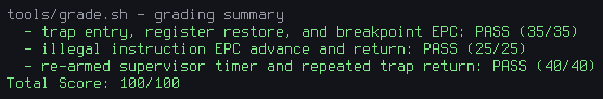
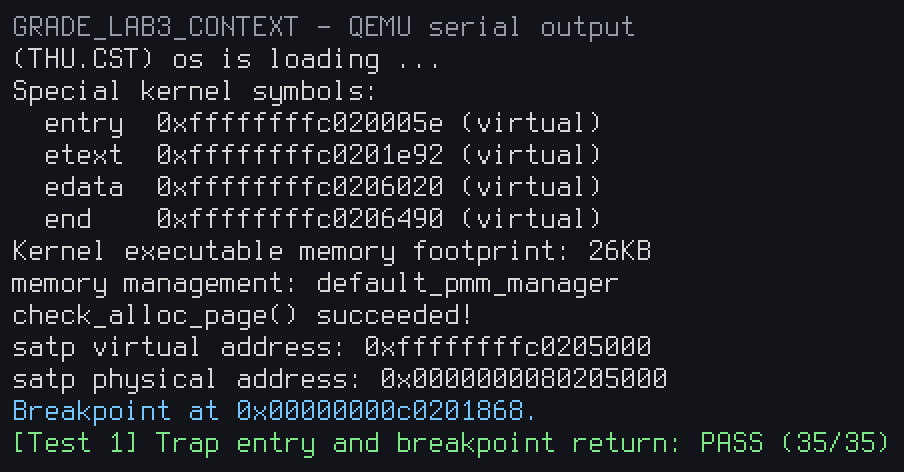
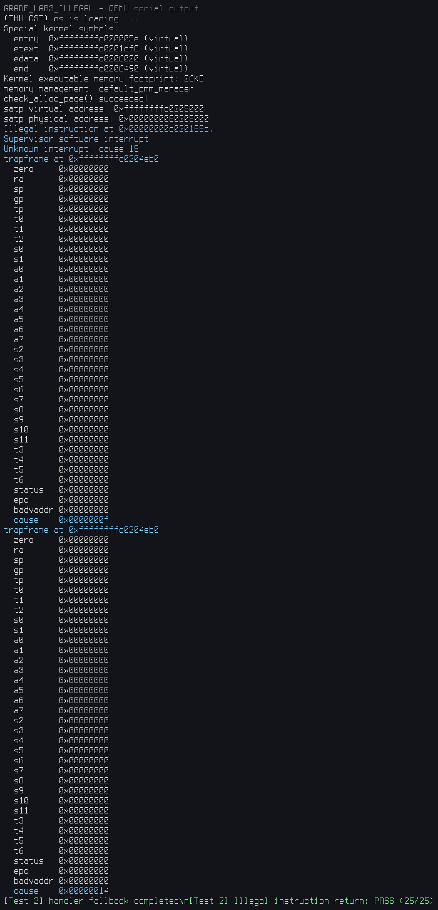
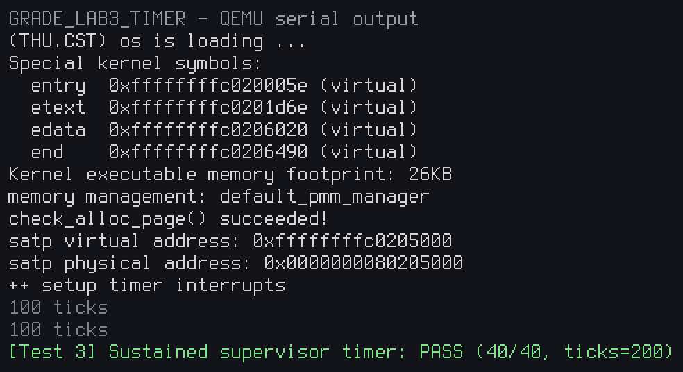

# RISC-V uCore Lab 3 实验报告

## 实验信息与分工

| 成员 | 分工 |
|---|---|
| A：2312681 仇晨宇 | `kern/trap/trapentry.S`：Trap 现场恢复与统一入口 |
| B：2311958 王健烨 | `kern/trap/trap.c`：中断和异常分发、时钟处理 |
| C：2313107 程晓耘 | 合入 Lab2 内存管理代码、修复启动链路、整合与测试、报告第 6/7 项、提交源码和报告 |

要求 4、5 由三位同学各自结合负责模块共同完成；本报告汇总各自的 spec、prompt、调试问题和解决过程。C 负责实验报告要求 6、7。

## 一、实验目标

本实验围绕 RISC-V S 态的 Trap 机制展开：使内核能在发生中断或异常时保存处理器现场，识别事件并执行对应处理，最后恢复现场并返回。实验同时依赖启动阶段建立的 Sv39 映射、物理页管理和时钟驱动。

## 二、实验环境

| 项目 | 本次验证环境 |
|---|---|
| 操作系统 | WSL2 / Ubuntu |
| 交叉编译器 | `riscv64-unknown-elf-gcc 13.2.0` |
| QEMU | `qemu-system-riscv64 8.2.2` |
| 固件 | OpenSBI v1.3 |
| 构建与测试 | `make`, `make grade` |

小组成员使用的 AI 工具和模型不完全相同；本次集成过程使用 VS Code 中的 Copilot SDK 辅助检查与验证。AI 输出均以源码、反汇编和自动测试结果为准，不以生成结果本身作为正确性证明。

## 三、整体逻辑

内核从 `kern_entry` 开始运行。启动代码保存 hart ID 和 DTB 地址，建立初始 Sv39 映射，再跳转到高半区的 `kern_init()`。初始化阶段解析设备树、初始化物理页管理器、安装 Trap 入口并启动时钟。运行期间，硬件遇到中断或异常后跳转到 `stvec` 指定的 `__alltraps`；汇编入口构造 `trapframe` 并调用 C 函数 `trap()`；C 层按 `scause` 区分中断/异常并处理；最后汇编恢复寄存器、恢复 `sstatus/sepc` 并执行 `sret`。

可将主链路记为：

```text
启动映射与内存初始化
  -> idt_init 设置 stvec
  -> 硬件 Trap
  -> SAVE_ALL / trapframe
  -> trap() / trap_dispatch()
  -> interrupt_handler() 或 exception_handler()
  -> RESTORE_ALL / sret
```

## 四、功能模块与实现理解

### 4.1 A：Trap 汇编入口和现场恢复

`SAVE_ALL` 把 32 个通用寄存器以及 `sstatus`、`sepc`、`stval`、`scause` 保存到 `trapframe`。RV64 下一个槽位为 8 字节，整个 Trap frame 为 36 个槽位、共 288 字节。旧 `sp` 放在槽位 2，四个 CSR 快照放在槽位 32–35。

`__alltraps` 执行 `SAVE_ALL` 后令 `a0=sp`，把 Trap frame 指针作为第一个参数传给 `trap(tf)`。C 处理结束后跳转到 `__trapret`。`RESTORE_ALL` 先恢复 `sstatus/sepc`，再恢复通用寄存器；临时用来恢复 CSR 的 `s1/s2` 随后也从 Trap frame 恢复；旧 `sp` 必须最后加载，因为此前所有读操作都依赖当前 `sp` 指向 Trap frame。`sret` 根据恢复后的 CSR 返回。

### 4.2 B：C 层中断和异常处理

- `idt_init()` 清零 `sscratch` 并把 `stvec` 指向 `__alltraps`。
- `trap()` 调用 `trap_dispatch()`；`scause` 最高位区分中断和异常，低位表示具体原因。
- `interrupt_handler()` 识别各类中断。Supervisor timer 分支先调用 `clock_set_next_event()` 重设下一次时钟，再递增 `ticks`；每 100 ticks 输出一次，累计输出 10 次后调用 SBI 关机。
- `exception_handler()` 处理非法指令和断点异常，输出异常地址并按指令长度推进 `tf->epc`。指令低两位为 `11` 时按 4 字节推进，否则按 2 字节推进，以兼容本实验用到的 32 位与压缩指令。其他异常输出 Trap frame 供诊断。

`ticks` 只负责记录时钟事件；本实验没有在 timer handler 中实现进程调度或抢占式上下文切换。

### 4.3 C：内存管理合入与启动链路

Lab3 骨架的 `pmm.c` 留有 Lab2 初始化空缺。C 将已经完成的 Lab2 `page_init()` 与 Best-Fit 管理器合入 Lab3，同时保留 Lab3 的关中断保护接口。`page_init()` 从 DTB 获得物理内存范围，验证范围和上界，给每个页描述符初始化并先标为保留页，再把内核映像和页描述符数组之后、按页对齐的完整页面交给 `init_memmap()`。这样既不会把内核占用区，也不会把描述符数组自身误加入空闲链表。

整合时还修复了启动路径的两个紧密相关问题：

1. 初始页表只映射高半区。写入 `satp` 后，CPU 仍需从低端物理地址继续执行几条指令；未做恒等映射会在到达 `kern_init()` 前发生取指页故障。启动页表现在同时映射物理 DRAM 的恒等映射和高半区映射。
2. 打开分页前保存启动参数必须使用 PC 相对物理地址；使用 `lla` 避免位置无关工具链把数据地址变成高半区虚拟地址。

Best-Fit 是从 Lab2 带入的既有分配器，不是 Lab3 新设计的算法。它按空闲块大小选择满足需求的最小块，并在释放时与相邻空闲块合并。

## 五、提示词与 spec（要求 4）

每个模块的 spec 都从现有接口、数据布局和测试断言中提取，不只写“实现功能”，而是明确输入、状态变化、顺序约束、失败兜底和可观察验收结果。完整的可复用提示词汇总见 [prompt.md](./prompt.md)。

| 模块 | spec 的关键内容 | prompt 的组织方式 |
|---|---|---|
| A：汇编入口 | 固定 `trapframe` 槽位；恢复 CSR、通用寄存器、`sp` 的顺序；`a0` 传参；`sret` 返回；不修改 `SAVE_ALL` | ROLE 限定 RISC-V64/S 态和 psABI；RELY 列出源码事实；SPEC 写成逐项可测约束；对中转寄存器和 `sp` 顺序补充追问 |
| B：C 层处理 | `scause` 分类；timer 重新设定、计数、周期输出和关机；非法指令/断点推进 `epc`；未知事件输出 Trap frame | 限定修改范围与已有宏/接口；明确 16/32 位指令长度判断和未知原因行为 |
| C：整合验证 | 不改评分 sentinel；完整合入 A/B、Lab2 PMM；先验证启动再运行评分；评分通过后确认常规启动与关机 | 先核对官方树和队友实现，再按文件边界整合；将编译、逐项评分、正常启动设为验收条件 |

## 六、AI 生成代码与调试问题（要求 5）

### A 模块

A 的迭代记录指出，早期生成结果有以下易错点：提前恢复 `sp`、用 `s1/s2` 恢复 CSR 后忘记还原寄存器、没有把 Trap frame 通过 `a0` 传给 `trap()`、错误使用 `ret`、保存/恢复槽位不对称，以及把诊断 CSR 误当成需要写回的状态。处理方式是按 `SAVE_ALL` 和 `struct trapframe` 逐槽对照，并用寄存器哨兵测试验证。工具链不识别旧助记符 `sbadaddr` 时改用同一 CSR 的 `stval` 名称。

### B 模块

B 的核心边界是不能固定把异常返回地址加 4：RISC-V 压缩指令长度为 2 字节。实现按异常指令低两位选择 2 或 4 字节，并通过非法指令返回测试验证；timer 必须在每次中断中设置下一次事件，否则只会收到一次中断。

### C 整合

第一次在本机运行评分时，三项都没有测试输出。检查 OpenSBI 串口信息发现 `Next Address` 为 0：原脚本用 `-device loader` 装载 raw 镜像，但本机 OpenSBI 不会因此获得内核跳转地址。进一步检查后又发现启动页表漏掉低地址恒等映射，分页打开后无法继续从物理地址取指。C 合入 Lab2 已验证的启动实现，并将 QEMU 启动参数改为 `-cpu max -kernel`。这只修正运行环境与启动链路，测试注入、测试条件、sentinel 和分值均未改动；修复后评分通过。

另一个编译时发现的问题是 Lab3 的 `memlayout.h` 缺少 `PHYSICAL_MEMORY_END`，而合入的页初始化需要用它验证 DTB 给出的内存上界。C 补回与该工程 128 MiB DRAM 配置一致的上界常量，再重新 clean build。

## 七、测试和结果

### 7.1 自动评分

在合并后的 `lab3_new` 中执行：

```bash
make clean
make -j2
make grade
```

本机实测结果为 **100/100**：

| 测试项 | 检查内容 | 得分 |
|---|---|---:|
| Trap 入口、寄存器恢复和断点返回 | Trap frame、寄存器现场、断点返回 | 35/35 |
| 非法指令异常返回 | 异常提示、`epc` 推进及未识别事件路径 | 25/25 |
| 持续时钟中断 | 重设 timer、重复 Trap 返回、输出和 ticks 计数 | 40/40 |
| **总分** |  | **100/100** |









### 7.2 普通启动与关机

另行执行 `timeout 25s make qemu`，确认内核进入 `kern_init()`、DTB 报告 128 MiB 物理内存、Best-Fit 页分配器自检成功，并连续输出 10 行 `100 ticks`，最后输出 `Shutdown after 1000 ticks.`，QEMU 正常退出。评分脚本检查的是至少 200 次 timer 中断；1000 ticks 自动关机由这次普通启动单独确认。

## 八、重要知识点及与 OS 原理的联系（要求 6，C 负责）

| 实验知识点 | OS 原理中的对应概念 | 含义、关系和差异 |
|---|---|---|
| Trap 与 `scause` 分类 | 中断、异常、陷阱 | 中断通常由外部/计时事件异步触发；异常由当前指令同步触发。两者都进入内核保护现场，但原因和返回地址处理不同。本实验处理 timer、断点和非法指令，没有实现全部异常种类。 |
| `trapframe` 保存/恢复 | 处理器上下文与上下文切换 | Trap frame 保存一次陷入所需的寄存器状态，是恢复被打断执行流的基础。它本身不等于进程切换：本实验返回同一执行流，没有切换进程页表或调度另一个进程。 |
| `sstatus`、`sepc`、`sret` | 特权级和受控内核入口 | `sepc` 保存返回 PC，`sstatus` 保存返回特权状态等信息，`sret` 按这些状态返回。OS 原理描述的是隔离和受控转移；实验把它落实为 RISC-V CSR 与特权指令。 |
| `stvec` 与 `trap_dispatch()` | 中断向量和事件分发 | `stvec` 提供统一入口，内核再按原因号分发到 handler。实验采用公共汇编入口加 C 层分发；它不是每种事件各自拥有一套完整处理程序。 |
| 周期 timer 与 `ticks` | 时钟中断、时间片和调度基础 | 重新设置 timer 才能周期性产生中断；累计 ticks 是时间度量基础。但本实验仅统计/打印并关机，没有将 ticks 用于时间片轮转。 |
| Sv39 启动映射和物理页管理 | 虚拟内存、页表和物理页框分配 | 页表把虚拟页映射到物理页；页管理器分配连续物理页。实验启动时建立静态映射并管理空闲物理页，但没有实现按需分配、换页或用户地址空间隔离。 |
| Best-Fit 空闲块管理 | 连续内存分配与外部碎片 | Best-Fit 选择能满足请求的最小空闲块，释放时合并相邻块；它减少某些请求下的剩余碎片，但需要遍历空闲块，也不保证消除外部碎片。此分配器是 Lab2 代码，本次主要是合入 Lab3。 |

## 九、OS 原理重要但本实验未覆盖的内容（要求 7，C 负责）

1. **进程与线程调度**：实验没有多个可运行进程、就绪队列、优先级或调度策略，也没有在时钟中断中触发上下文切换。
2. **系统调用与用户态隔离**：没有实现用户程序通过 `ecall` 请求内核服务、参数校验和权限隔离的完整过程。
3. **按需虚拟内存**：没有实现用户页表、缺页异常处理、按需分配、写时复制或页面换入换出。
4. **SMP 并发与同步**：本实验使用单 hart；没有覆盖多核竞争、锁、原子操作、内存序和跨核 TLB shootdown。
5. **死锁与资源管理**：没有多个进程争用资源的建模、死锁预防/检测/恢复。
6. **文件系统和完整设备驱动**：没有覆盖文件/目录、缓存一致性、块设备请求队列及通用驱动框架。
7. **安全与隔离机制**：没有完整讨论用户/内核地址空间隔离、权限最小化、访问控制和安全边界验证。

这些知识点与本实验并不矛盾，而是建立在 Trap、上下文、页表和中断等底层机制之上；本实验提供的是后续实现它们所需的入口和基础设施。

## 十、总结

本实验的关键不只是“让异常处理函数能运行”，而是汇编入口、Trap frame、CSR、C 层分发和返回指令必须遵守同一份状态契约。汇编恢复要逐槽验证，timer 要重新设定下一次事件，异常要按实际指令长度推进 EPC。整合时还必须验证启动页表和 QEMU 的固件交接，否则内核可能根本没有执行到评分代码。最终以 clean build、100/100 评分和 1000 ticks 后正常关机共同验证结果。
